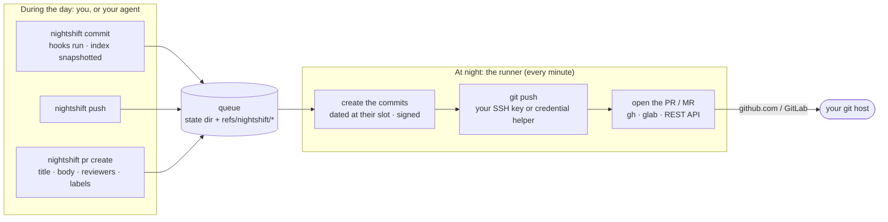

[](https://github.com/michaelbeutler/nightshift/actions/workflows/ci.yml)
[](https://github.com/michaelbeutler/nightshift/releases)
[](https://goreportcard.com/report/github.com/michaelbeutler/nightshift)
[](LICENSE)

# ☾ nightshift

**Schedule send for git.** Write your commits, your push and your pull request whenever
it suits you, and nightshift delivers them tonight.

You know *Schedule send* in Outlook, Gmail or Teams: you write the message now, and it goes
out at 7:30 tomorrow. nightshift does that for git. You commit as usual, then ask for the
push and the pull request with its body, reviewers and labels, and nightshift queues it
all locally. In the night window a small runner creates the commits (dated then and signed
then), pushes them with your own git, and opens the pull request on GitHub or the merge
request on GitLab. In the morning your branch is where you left it, now committed, and
`git status` is clean.


It uses what you already have. Pushing is your `git push`, with your SSH keys, agent,
credential helper, `insteadOf` rules and hooks. Signing is your `gpg.format`, whether
that's SSH, OpenPGP or X.509. Pull requests go through `gh` or `glab` when they are
installed, and through the REST API otherwise. It is a single Go binary that depends only
on Cobra and Viper, and AI agents can drive it over MCP.

---

## Contents

- [Why](#why)
- [Features](#features)
- [How it fits together](#how-it-fits-together)
- [Install](#install)
- [Quickstart](#quickstart)
- [Commands](#commands)
- [When things happen](#when-things-happen)
- [Pushing, signing and pull requests](#pushing-signing-and-pull-requests)
- [For AI agents](#for-ai-agents)
- [Configuration](#configuration)
- [Good to know](#good-to-know)
- [Contributing](#contributing)
- [License](#license)

## Why

- **Ship on your team's clock, not yours.** Work late or early, from another time zone, or
  in one long afternoon, and land the changes when people are ready for them.
- **Keep flow.** Commit freely without starting CI and review notifications for every
  half-finished thought. Batch the noise into one quiet window.
- **Separate writing from publishing.** The same split as drafting an email and sending
  it later. You decide what goes in now, and nightshift decides when it goes out.
- **Let your agent work all day and publish at night.** Claude Code, Codex or Cursor can
  prepare commits and a PR with a full description, and the PR shows up the next morning.

## Features

- **Buffered commits.** `nightshift commit` works like `git commit`, with `-a`, paths,
  `-m`, `-F`, the editor, `--amend`, `--signoff`, `--author` and `--no-verify`. Your hooks
  run right away, while you are there to fix them. The commit object is only created at its
  scheduled time, and gets that time as both author and committer date.
- **Signed at night.** When you sign commits, the signature is made when the commit is
  made, with whatever `gpg.format` says. `nightshift doctor` checks that the key can sign
  without a prompt.
- **Pushes and PRs on schedule.** The push runs after the branch's last buffered commit,
  and the pull or merge request a few minutes after that, with title, Markdown body (or
  `--fill`), base, draft, reviewers (including GitHub teams), assignees, labels and
  milestone.
- **GitHub and GitLab, hosted or self-managed.** github.com, GitHub Enterprise Cloud and
  Server, gitlab.com and self-managed GitLab. SSH aliases are resolved, and any other host
  is one config entry. Pushing works with every git server.
- **Every way you authenticate.** For pushes: SSH keys and agents (1Password and
  gnome-keyring included), HTTPS credential helpers and Git Credential Manager. For PRs:
  `gh`/`glab` logins, environment tokens, a `token_cmd` such as `op read …`, or your git
  credential helper. nightshift itself stores no secrets.
- **Exact or natural timing.** `--at "2026-12-01 02:00"` (or `01.12.2026 02:00`,
  `dec 1 2am`, `tomorrow 01:30`, `+2h`, with an optional time zone) happens exactly then,
  to the second. Without `--at`, work lands at a random time in the window
  (`01:00-04:00` by default), with a few random minutes between consecutive steps.
- **Catches up after sleep.** The runner starts every minute and again on wake. Overdue
  commits keep their night dates, or move to the next night if you configure
  `schedule.missed: next-window`.
- **Safe by design.** It never forces a push or rewrites published history, and never
  overwrites your files. If a branch moved under its buffered commits, the job stops and
  tells you. Failed pushes and PRs are retried with backoff, and you get a desktop
  notification when something needs you.
- **Already committed?** `nightshift adopt` turns unpushed commits into buffered ones, so
  they are recreated at night with the same content.
- **Built for agents.** `nightshift mcp` is an MCP server, and every command has `--json`.

## How it fits together



A day with nightshift looks like this:

```text
17:42  nightshift commit -am "feat(parser): support nested blocks"   → commit at 01:36
17:43  nightshift pr create --fill -r octocat -l enhancement         → push 01:41, PR 01:51
       … you log off, the laptop sleeps …
01:36  runner  commit 9b17b85 (signed, dated 01:36)
01:41  runner  git push origin feat/nested-blocks
01:51  runner  gh pr create → https://github.com/acme/rocket/pull/42
```

The design, step by step, is in [docs/how-it-works.md](docs/how-it-works.md).

## Install

```sh
go install github.com/michaelbeutler/nightshift@latest
```

Or download a binary for macOS, Linux or Windows from the
[releases](https://github.com/michaelbeutler/nightshift/releases). nightshift needs git
2.36 or later. `gh` or `glab` are used when present but are not required.

Then, once per machine:

```sh
nightshift service install   # launchd on macOS, a systemd user timer on Linux, Task Scheduler on Windows
nightshift doctor            # inside a repository: can tonight's run push, sign and open PRs?
```

## Quickstart

```console
$ git switch -c feat/nested-blocks
$ $EDITOR src/parser.go

$ nightshift commit -am "feat(parser): support nested blocks"
☾ Buffered gah70c on feat/nested-blocks for tonight 01:36 (in 7h54m)
    feat(parser): support nested blocks
    2 files changed, 7 insertions(+), 3 deletions(-)

$ nightshift pr create --fill --reviewer octocat --label enhancement
⇄ Scheduled a pull request feat/nested-blocks → main on github.com for tonight 01:51 (in 8h10m)
    feat(parser): support nested blocks
    reviewers octocat · labels enhancement
    after push ybdavy at tonight 01:41

$ nightshift status
On branch feat/nested-blocks
  ☾ commit gah70c tonight 01:36 (in 7h54m)  feat(parser): support nested blocks
  ↑ push   ybdavy tonight 01:41 (in 7h59m)  → origin
  ⇄ pr     htnhs4 tonight 01:51 (in 8h10m)  "feat(parser): support nested blocks" → main
```

Keep working, and buffer more commits; they go after the first, and the push moves behind
them. Changed your mind? `nightshift reschedule gah70c "tomorrow 02:00"` moves the branch,
and `nightshift reschedule gah70c now` ships it on the next pass.
`nightshift cancel gah70c` drops it, and your changes stay in your working tree.

## Commands

| Command | What it does |
| --- | --- |
| `commit [-a] [-m msg \| -F file] [--amend] [--at when] [paths…]` | Buffer the index as a commit created at its slot. Also `--signoff`, `--author`, `--no-verify`, `--allow-empty`, `-S`/`--no-gpg-sign`. |
| `adopt [<since>] [--at when]` | Turn unpushed commits made with plain git into buffered ones. |
| `push [<remote> [<branch>]] [--at when]` | Schedule the push, after the branch's buffered commits. Also `--force-with-lease`. |
| `pr create` (or `mr create`) | Schedule a pull/merge request, and the push if needed: `-t` title, `-b`/`-F` body (or `--fill`, or your editor with the repo's PR template), `-B` base, `-d` draft, `-r` reviewer, `-a` assignee, `-l` label, `-m` milestone, `--target-repo` for forks, `--at`, `--replace`. |
| `status` | What is planned for the current branch, and what is staged but not buffered yet. |
| `list [--all] [--here]` | Every scheduled job, in every repository. |
| `show <id> [--patch]` | A job in full; for a buffered commit, its diff. |
| `reschedule <id> <when>` | Move a job, and everything after it, by the same amount. |
| `cancel <id>…` | Cancel jobs (and what cannot happen without them). Your files are never touched. |
| `retry <id>` | Queue a failed job again. It keeps its time, so a commit keeps its date. |
| `run [--dry-run]` | Run what is due now. The service calls this every minute. |
| `daemon [--interval 30s]` | Keep running in the foreground (containers, tmux). |
| `service install \| uninstall \| status` | The background runner. |
| `doctor` | Check git, the runner, push access, signing and PR auth, the way the night run will. |
| `mcp` | Serve the tools to AI agents over MCP (stdio). |
| `config init \| path \| show` | Write a commented config, show where files live, print the effective settings. |

Every command takes `--json`, `-C <dir>` and `--config <file>`. Job IDs can be shortened
to any unique prefix.

## When things happen

Every scheduling command takes `--at`. Give it an **exact** date and time and that is
when it happens, to the second, and the commit is dated exactly then. Give it a **loose**
time, or nothing, and nightshift picks a natural moment.

| Exact (kept to the second) | |
| --- | --- |
| `2026-12-01 02:00`, `2026-12-01 02:00:30`, `2026-12-01T02:00` | ISO date and time |
| `01.12.2026 02:00`, `2026/12/01 02:00` | European and slash dates |
| `dec 1 2am`, `1 Dec 2026 02:00`, `December 1st, 2026 at 02:00` | month names; without a year, the next such date |
| `tomorrow 01:30`, `today 23:00`, `fri 02:00`, `02:30`, `11:45pm` | a day and a time of day, or the next time the clock shows it |
| `+2h`, `in 90m` | from now |
| `2026-12-01T02:00:00+01:00`, `@1796090400` | RFC 3339, Unix seconds |
| `… UTC`, `… +05:30`, `… Europe/Zurich` | any of the above in another time zone |

| Loose (nightshift picks the moment) | |
| --- | --- |
| *(nothing)* or `tonight` | a random time in `schedule.window` (`01:00-04:00`), or a few minutes after the step before |
| `01:00-03:00` | a random time in the next such window |
| `2026-12-01`, `dec 1`, `fri` | a random time in that day's window |
| `now` | on the runner's next pass |

```sh
nightshift commit -am "feat: launch" --at "2026-12-01 09:00 Europe/Zurich"
nightshift pr create --fill --at "2026-12-01 09:05 Europe/Zurich"   # pushes a few minutes before
```

The steps of a branch always run in order: commits, then the push, then the pull
request. A loose time that would come too early moves to a random `schedule.spacing`
(`3m-15m`) after the step before. An exact time is never moved; one that is not after
the step it waits for is refused with the time of that step. A pull request with an
exact time pulls the push it needs to just before it. If the machine is asleep, overdue
steps run as soon as it wakes, and commits keep their scheduled dates.

## Pushing, signing and pull requests

nightshift asks your tools to do everything, so it works whichever way you are set up,
provided it works **without a prompt**. `nightshift doctor` checks exactly that:

```console
$ nightshift doctor
✓ git            git 2.54.0
✓ runner         launchd agent io.github.michaelbeutler.nightshift runs nightshift every minute
✓ queue          3 pending, 0 failed (state in /Users/ada/.local/state/nightshift)
✓ identity       Ada Lovelace <ada@example.com>
✓ push           origin (github.com/acme/rocket) accepts pushes without a prompt
✓ pull requests  github via gh is installed and logged in to github.com
✓ signing        ssh signing works without a terminal
✓ signing        the SSH signing key is loaded in ssh-agent
```

| | Supported |
| --- | --- |
| Push | SSH (keys, ssh-agent, macOS keychain, 1Password, gnome-keyring, aliases), HTTPS (osxkeychain, Git Credential Manager, libsecret, `gh`/`glab auth setup-git`), any git transport |
| Signing | `gpg.format` ssh, openpgp and x509, when the key works unattended |
| PR auth | `gh`/`glab` login, `GH_TOKEN`/`GITHUB_TOKEN`/`GH_ENTERPRISE_TOKEN`/`GITLAB_TOKEN`, a per-host `token_env` or `token_cmd`, the git credential helper |

The details for each key type and token source are in
[docs/authentication.md](docs/authentication.md).

| Host | Push | Pull / merge requests |
| --- | :---: | --- |
| GitHub, GitHub Enterprise Cloud & Server | ✓ | ✓ via `gh` or the REST API |
| GitLab.com & self-managed GitLab | ✓ | ✓ via `glab` or the REST API |
| Gitea / Forgejo | ✓ | [help wanted](#contributing) |
| Bitbucket | ✓ | [help wanted](#contributing) |
| Azure DevOps | ✓ | [help wanted](#contributing) |
| any other git server | ✓ | n/a |

## For AI agents

Let your agent prepare the work and nightshift deliver it:

```sh
claude mcp add nightshift -- nightshift mcp     # Claude Code
codex mcp add nightshift -- nightshift mcp      # Codex CLI
```

The server offers `schedule_commit`, `schedule_push`, `schedule_pull_request`,
`adopt_commits`, `branch_status`, `list_jobs`, `show_job`, `reschedule_job`, `cancel_job`,
`retry_job` and `doctor`, and tells the model to use them instead of `git commit`,
`git push` and `gh pr create`. Prefer the shell? Every command speaks `--json`.
[docs/agents.md](docs/agents.md) has the setup for other clients and a snippet for your
`AGENTS.md`.

## Configuration

Optional. `nightshift config init` writes a commented file to
`~/.config/nightshift/config.yaml` (or `$XDG_CONFIG_HOME`):

```yaml
remote: origin
sign: auto                 # auto (commit.gpgSign) | always | never
notify: failures           # failures | all | off
schedule:
  window: "01:00-04:00"
  spacing: "3m-15m"
  missed: run              # run | next-window
  grace: 2h
pr:
  method: auto             # auto (gh/glab, else API) | cli | api
  draft: false
  reviewers: []
  labels: []
providers:
  - host: git.example.com
    type: gitlab
    token_cmd: op read op://dev/gitlab/token
```

Every key can also be set as an environment variable: `NIGHTSHIFT_SCHEDULE_WINDOW=02:00-05:00`.
The queue and the runner's log live in `~/.local/state/nightshift`
(`nightshift config path`).

## Good to know

- **Commit dates move, server timestamps don't.** The commits carry their night dates.
  GitHub and GitLab record when a push or a pull request arrives themselves, so nightshift
  sends those at night too, which means the machine has to be awake then or catch up when
  it wakes. On macOS, `sudo pmset repeat wakeorpoweron MTWRFSU 01:00:00` wakes it for the
  window.
- **Buffered changes stay staged** in your working tree until the night run commits them,
  so you can keep working. Don't commit them with plain `git commit`; if you did, `adopt`
  is the way back.
- **One machine, one queue.** The machine that buffered the work is the one that delivers it.

## Contributing

nightshift is young, and there's plenty of room to shape it. You don't need to know the
codebase. These are good places to start:

- **A new git host.** Gitea/Forgejo, Bitbucket and Azure DevOps each need one
  `provider.Provider` (a CLI path and/or a REST path) plus tests against an `httptest`
  server. GitHub and GitLab in [`internal/provider`](internal/provider) show the way, at
  around 250 lines each.
- **Merge requests from forks on GitLab**, and other provider features (auto-merge,
  projects, `--squash`).
- **Packaging.** A Homebrew tap, Scoop, winget, AUR or Nix.
- **Platform polish.** Windows notifications, waking the machine for the window, and a
  `nightshift log` command.
- **Docs and examples.** Your setup (1Password, YubiKey, GitHub Enterprise, a container
  runner) written up for the next person.

Start with [CONTRIBUTING.md](CONTRIBUTING.md) for the setup (`just check` is the whole
gate) and the conventions, and [CLAUDE.md](CLAUDE.md) for the invariants a change has to
keep. Look for issues labeled
[`good first issue`](https://github.com/michaelbeutler/nightshift/labels/good%20first%20issue)
or [`help wanted`](https://github.com/michaelbeutler/nightshift/labels/help%20wanted), or
[open one](https://github.com/michaelbeutler/nightshift/issues/new/choose) to talk it
through before you write code. Bug reports with `nightshift doctor` output are gold.
Found a security issue? Please follow [SECURITY.md](SECURITY.md) instead of opening an
issue.

## License

MIT. See [LICENSE](LICENSE).
